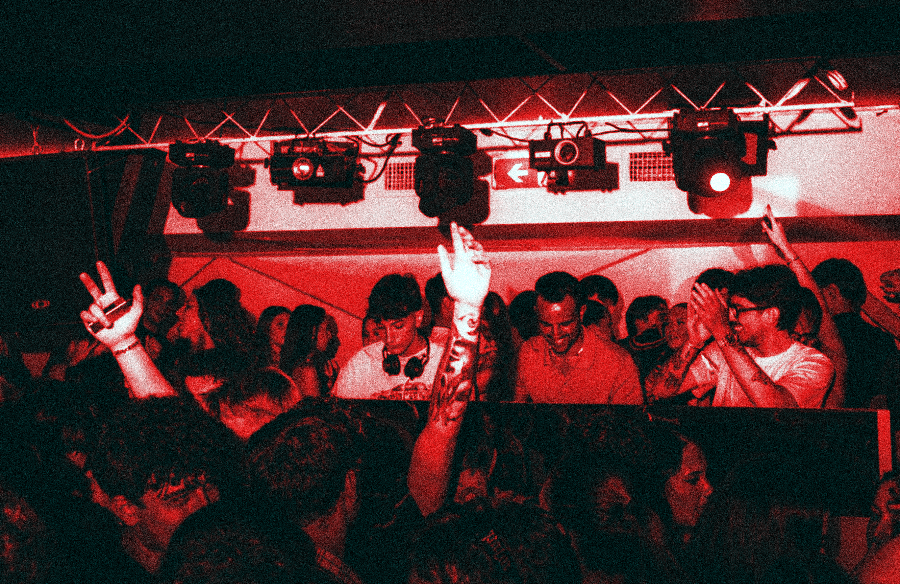

  

 

  &nbsp;&nbsp;&nbsp;

 

<table>
  <tr>
    <td width="50%" valign="top">
      <h3> &nbsp;SYSTEMS & ENGINEERING</h3>
      

        Computer Science undergraduate at <b>SUPSI</b> in Lugano, focused on building reliable software from bare-metal hardware up to modern user interfaces.
      

      <ul>
        <li><b>Low-Level & Embedded:</b> C programming, ARM Linux runtime hooking, microcontrollers (<code>PIC32MX</code> / Basys MX3), and digital logic.</li>
        <li><b>Software Architecture:</b> Object-Oriented Design in Java, algorithms & data structures, databases, and network protocols.</li>
        <li><b>Pragmatic Approach:</b> First-principles debugging, clean builds, and cross-platform workflows on macOS (Apple Silicon) & Linux.</li>
      </ul>
    </td>
    <td width="50%" valign="top">
      <h3> &nbsp;AUDIO TECH & LIVE SETS</h3>
      

        Bridging software engineering with live electronic music performance under the stage name <b>Luis</b> across <b>Varese, Milan, and Lugano</b>.
      

      <ul>
        <li><b>Hardware Modding:</b> Extending standalone DJ hardware capabilities via memory-resident modules and custom desktop toolkits.</li>
        <li><b>Audio DSP:</b> Developing cross-platform VST plugins and automated audio/library workflows for Rekordbox & Serato.</li>
      </ul>
    </td>
  </tr>
</table>

 

###  &nbsp;SELECTED ENGINEERING WORK

| Project | Architecture & Focus | Stack |
| :--- | :--- | :--- |
| **[rx3-toolkit (Custom Fork)](https://github.com/luisenlanoche/rx3-toolkit)** | Custom fork & modules for **Pioneer XDJ-RX3**. Adds standalone Stems control, Sample Pads, Key Sync, and UI tweaks via USB memory injection without flashing firmware. | `C` `ARM` `Python` `LD_PRELOAD` |
| **Custom VST Audio Plugin** | Cross-platform real-time audio processing plugin engineered from scratch for **macOS (`arm64`)** and **Windows** DAW environments. | `C++` `DSP` `Audio` |
| **PIC32 Embedded Systems** | Bare-metal firmware development, hardware interrupts, timers, and peripheral control on **Digilent Basys MX3** (`PIC32MX370F512L`). | `C` `MPLAB X` `Embedded` |

 

###  &nbsp;TECH STACK & ENVIRONMENT

  
<b>Languages & Core</b>

  
  
  
  
  
  
  

  
<b>Systems, Networking & Creative Tools</b>

  
  
  
  
  
  
  
  

 
